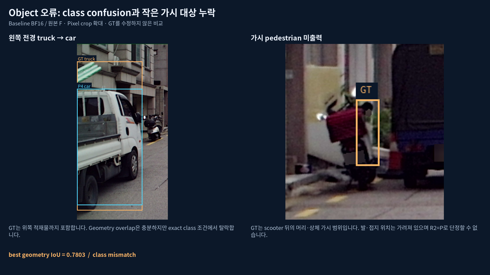
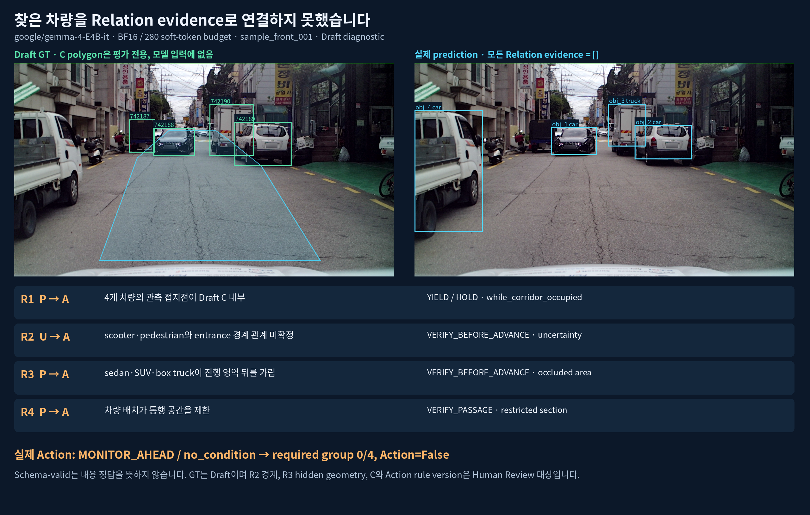

# Kakao Mobility VLM dry run — v1

단일 F 이미지에서 Object·Relation·Action 출력을 생성하고, 낮은 점수의 원인과 schema 준수 여부를 확인한 결과입니다. **Baseline Object 3/16, Relation 0/4, Action=False**가 좌표·IoU·assignment 재검산에서도 재현됐습니다. Prompt 수정 후 첫 출력의 schema는 통과했지만 Relation은 여전히 0/4입니다.

**모든 GT는 Draft이며 Human Reviewed sample은 0개입니다.** 아래 수치는 단일 장면 진단 결과입니다. 공식 benchmark 점수나 generalization 성능으로 해석하지 않습니다. GT와 evaluator 판정은 수정하지 않았습니다.

## 실행 조건과 입력

- Model: `google/gemma-4-E4B-it`
- Revision: `4ecc2ba63bcac23ba4a767fc87025b1450f84c9c`
- Sample: `sample_front_001`, Track 1, single image, F view, 1920×1080, intent `follow_visible_road_forward`
- Input: F 이미지 + whitelist task JSON + ZIP system prompt + 전체 JSON Schema. B/L/R, GT bbox/ID, C polygon, reference와 expected answer는 inference prompt에 넣지 않았습니다.
- Decode: seed 42, greedy, max_new_tokens 4096, image soft-token budget 280. Original prompt 3851 tokens, modified prompt 4178 tokens.
- Baseline은 기존 `bf16_280` 첫 출력을 사전에 고정했습니다. 대표 JSON은 가장 먼저 완료된 modified-prompt base NF4 첫 출력으로 고정했습니다.

Source는 `integrated-sample-0.2`입니다. PDF의 `aba16a3`는 과거 v0 참조이며 현재 model revision이 아닙니다. [원본 PDF](../docs/benchmark/Kakao_Road_VLM_Benchmark_Spec_Final.pdf), [입력 파일 hash](provenance.json), [checkpoint hash](environment/model_file_hashes.json)를 함께 보존했습니다.

## 결과

| Run | 단계 | Strict schema | Fence 제거 후 schema | Object / Relation / Action |
|---|---|---|---|---|
| bf16_280 | 기존 첫 출력 | False | True | 3/16 · 0/4 · False |
| nf4_280 | 기존 첫 출력 | False | False | N/A |
| qlora_280_reloaded | 기존 첫 출력 | False | False | N/A |
| nf4_prompt_v1_first | 수정 prompt 첫 출력 | True | True | 4/16 · 0/4 · False |
| qlora_prompt_v1_first | 수정 prompt 첫 출력 | True | True | 3/16 · 0/4 · False |
| nf4_original_failure_retry | 기존 실패의 model retry #1 | False | True | 2/16 · 0/4 · False |
| qlora_original_failure_retry | 기존 실패의 model retry #1 | False | True | 2/16 · 0/4 · False |

Schema-invalid 출력의 semantic quality는 N/A입니다. Fence 제거는 모델 재시도가 아니며 missing field를 채우지 않습니다. Modified prompt 첫 출력과 기존 실패에 대한 retry는 별도 조건입니다. `regions=[]`는 모델이 생성한 값으로, Region grounding 성공을 뜻하지 않습니다. [원문·schema 비교](reports/output_schema_comparison.md), [attempt protocol](audit/attempt_protocol.json)

## 실패 원인

1. **Object:** 분모 16은 F Object 전체입니다. Source Box 10개 + AI-added Draft Box 6개이며 Region과 다른 view 객체는 포함되지 않았습니다. Left truck은 geometry IoU 0.7803이어도 `car`로 예측하여 class exact 조건에서 탈락했습니다. 작은/가린 대상의 누락도 있습니다. [16개 매칭표](reports/object_matching.md)
2. **Relation:** 주요 차량 3개를 찾았어도 evidence를 연결하지 않고 R1–R4 모두 A를 출력했습니다. R2에서는 입구·footprint의 불확실성을 A로 처리했습니다. Object 누락만으로 설명되지 않는 관계 판단 오류입니다. [문항별 근거와 판정](reports/relation_action_analysis.md)
3. **Action:** `MONITOR_AHEAD / no_condition`으로 Draft의 required group 4개를 모두 놓쳤습니다. PDF Roadside-only 예외와 ZIP Actor 규칙이 다르지만 현재 Draft에 travel_space Actor가 있어 이번 실패가 그 차이만으로 바뀌지는 않습니다.
4. **Format:** 기존 NF4·학습 후 출력에서 필수 `regions`가 누락됐습니다. 규칙과 schema를 유지한 required-fields addendum으로 두 첫 출력은 strict schema를 통과했습니다. Semantic 개선은 입증하지 못했습니다. [Prompt와 diff](prompts/system_prompt.diff)





## Training audit와 데이터 준비 상태

기존 QLoRA는 같은 장면의 Draft `prediction.example.json`을 사용한 5-step smoke입니다. **6040 = masked prompt 3851 + supervised 2189**이며 target과 loss mask, adapter 업데이트·저장·재로드가 정상임을 확인했습니다. Held-out evaluation이 아닙니다. [Target·loss mask 분석](reports/qlora_audit.md)

데이터는 source group 1개, 문항 1개, Reviewed sample 0개입니다. Track 2·3은 temporal input과 GNSS/INS가 없어 분모 0 / N/A입니다. 데이터·정답 문제와 모델 문제를 구분한 [개선 계획](reports/improvement_plan.md), 사람이 판정을 확정할 [25개 Human Review CSV](reports/human_review.csv), [데이터 준비 상태](data_readiness.md)를 제공합니다.

## 빠른 검토와 재현

- [대표 schema-valid inference JSON](representative_inference/parsed_output.json) · [모델 raw output](representative_inference/raw_output.txt)
- [원본 좌표 overlay](figures/coordinates_original.png) · [16개 Object crop](figures/object_crops_16.png)
- [Interactive demo](demo.html): repository를 내려받아 파일을 열거나 아래 local server로 확인하십시오. GitHub 파일 화면에서는 HTML을 실행하지 않습니다.

```bash
# repository root, Python 3.10+; 아래 검증은 GPU와 model download 없이 실행됩니다.
PYTHONDONTWRITEBYTECODE=1 python kakao_dryrun/scripts/reproduce_quality.py
PYTHONDONTWRITEBYTECODE=1 python kakao_dryrun/source/integrated_annotation_sample/scripts/test_evaluation.py
python -m http.server 8000 --directory kakao_dryrun
# http://localhost:8000/demo.html
```

재현 script는 저장된 decoded output을 strict JSON/schema로 검증하고, 필요한 경우 전체 Markdown fence만 제거한 결과를 별도로 검증합니다. 저장된 metrics와 diagnostics/action 결과를 비교하며 원본을 덮어쓰지 않습니다. 새 model generation은 실행하지 않습니다.

## 파일 구성과 원본 보존

| 경로 | 내용 |
|---|---|
| source/integrated_annotation_sample | 원본 sample package, schema, Draft annotation, validator/evaluator와 tests |
| original_evidence/runs | BF16·NF4·학습 후 baseline 3개 |
| runs | modified prompt 첫 출력 2개와 기존 실패 retry 2개 |
| prompts / representative_inference | Original/modified prompt와 대표 출력 |
| reports / audit | 실패 분석, 검토표, 좌표/assignment 및 mask 검증 |
| figures / demo.html | 발표용 이미지와 offline viewer |
| training_audit | Training target, mask와 adapter 검증 기록; weights 없음 |

Raw output, prediction, metrics, GT와 evaluator는 원본 그대로입니다. Config는 model/prompt/decode 설정만 추려 게시했고 messages의 machine-local image path는 상대 경로로 바꿨습니다. 원본·게시본 hash와 변환 내역은 [export manifest](audit/export_manifest.json)에 있습니다.

GPU memory·latency·throughput 비교, allocator-budget 실험, 규모별 학습 시간 계산, AWS 실행 bundle은 포함하지 않았습니다. Model/adapter weights, runtime/cache, 인증정보도 제외했습니다. 로컬 원본 dry_run_results와 audit 결과는 보존했습니다.
